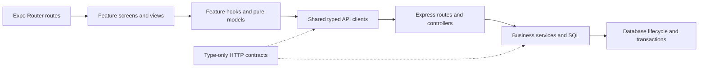

# Architecture and maintenance

## Boundaries

`src/app` contains only route entry points and navigator layouts. Feature folders own their screens, components, hooks, and domain calculations. Checkout reuses catalog search/scanning components. Shared frontend modules must not import feature modules. Static assets stay in `assets`; styling code and font loading belong to frontend shared modules.

`shared/contracts.ts` contains interfaces and type aliases only. Frontend code imports these with `import type`; backend JavaScript consumes them through JSDoc imports. Backend checking has a separate Node configuration and emits no build files. HTTP field names, statuses, default sorting, and response shapes are preserved.

## Frontend state

- `api/http` handles JSON, empty `204` responses, headers, cancellation, and typed errors. Domain clients describe endpoints. Transport never automatically retries a write.
- `useLatestRequest` aborts superseded reads and invalidates their responses even if cancellation is ignored by the underlying transport.
- `useFocusedResource` loads on focus, hides results on filter changes, and retains successful data after a failed same-filter refresh. Dashboard and analytics additionally refresh on foreground return and Philippine midnight.
- `useProductCatalog` separately owns search debounce, server pagination, and search-only checkout behavior. Pages cannot enter a superseding search.
- `useProductForm` owns form initialization, client validation, save errors, and a synchronous duplicate-save guard for inventory and restoration.
- `useReceipt` scopes receipt requests to an opening, including reopening the same receipt after closing it.
- The checkout reducer owns cart changes and availability reconciliation. Pure selectors perform arithmetic in integer centavos. `useCheckout` owns submission, stock lookup, pending transaction IDs, and explicit retries. Network failures, server failures, and invalid success responses retain the transaction; a definitive client error releases it. A `409` additionally refreshes catalog and cart data.

Feature hooks own the choice to refresh or retry; views receive typed values and callbacks. Native/web picker files remain separate. List virtualization and the checkout keyboard hook remain in place.

## Backend responsibilities

`createApp()` builds middleware and routes without I/O. The executable server entry point initializes the database before listening. Services validate input and enforce business rules; controllers preserve their existing domain-specific HTTP error messages through the shared error helper.

Database initialization loads the configured SQLite file, applies the existing idempotent schema and legacy backfills, and persists it. Tokenization is a lower-level utility, so database initialization does not depend on a business service. Shared transaction handling commits or rolls back synchronously. File persistence remains explicit after commit, preserving the previous ordering and durability behavior.

SQL result conversion is the typed boundary for query projections. JSDoc row annotations must match their SELECT columns; type checking is not runtime schema validation. Receipt names and unit prices remain historical snapshots. Barcode aliases, deletion restrictions, stock updates, idempotent sale IDs, indexes, and database format are unchanged.

## Verification

Run `npm run check` after each feature change. The suite covers transaction retries, duplicate submission, monetary calculations, validation, cancellation, stale results, search pagination, refresh lifecycle, database backfills, receipt history, and timezone boundaries. Native device acceptance checks are listed in the root README.

Existing shop data must remain outside tests. Use temporary databases and never start the development API against the shop database to run automated checks. CI additionally exports bundles for Android, iOS, and web.
