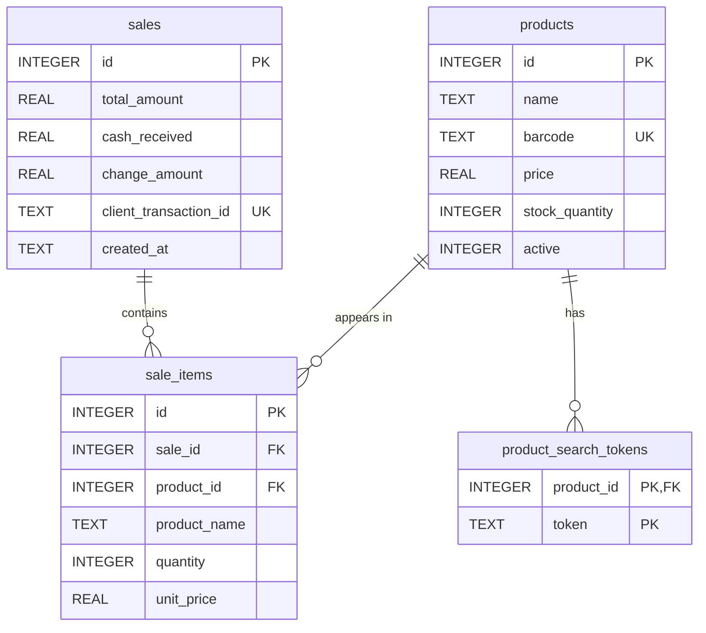

# Database Structure

**Mobile POS and Inventory System**  
CS15L - Programming Languages Final Project

## 1. Database overview

The Mobile POS and Inventory System uses an API backend with a relational SQLite database. The React Native application sends HTTP requests to a Node.js/Express API. The backend uses **sql.js** to load and query the database in memory, then exports committed changes to **`backend/pos.sqlite`**. The file is stored on the backend server. Its location can be changed through the `DATABASE_PATH` environment variable.

The database has four application tables:

| Table | Purpose |
| --- | --- |
| `products` | Stores product details, barcodes, prices, available stock, and archive status. |
| `sales` | Stores one record per completed sale, including total, payment, change, and date. |
| `sale_items` | Stores the products, quantities, and historical prices on each receipt. |
| `product_search_tokens` | Stores normalized words from product names to support product search. |

Dashboard totals, sales trends, top products, receipt line totals, and deletion eligibility are calculated from these tables; they are not separate stored tables or columns. SQLite's internal `sqlite_sequence` table manages auto-increment values and is not an application entity.

## 2. Entity relationship diagram

**Key:** PK = primary key; FK = foreign key; UK = unique value or unique index. `product_search_tokens` uses the combination of `product_id` and `token` as its primary key. `sales.client_transaction_id` is nullable; its unique index applies to non-NULL values.

### Relationships

- Each `sale_items` record belongs to exactly one sale and exactly one product.
- A product can appear in zero or many sale items across different sales.
- A sale can have zero or many item rows at the database-constraint level. The checkout API requires at least one item for every new sale.
- A product can have zero or many search tokens. Each token row belongs to one product. Deleting a product cascades to its search tokens.
- `sale_items` resolves the many-to-many relationship between products and sales.

## 3. Data dictionary

Fields are required unless marked **nullable**. All `id` primary keys are automatically generated with `AUTOINCREMENT`.

### 3.1 `products`

| Field | SQL type | Database rules | Description |
| --- | --- | --- | --- |
| `id` | INTEGER | Primary key; AUTOINCREMENT | Unique product identifier. |
| `name` | TEXT | NOT NULL | Product display name. The API rejects blank names. |
| `barcode` | TEXT | NOT NULL; UNIQUE | Barcode used for lookup and scanning. The API also rejects equivalent UPC/leading-zero aliases assigned to another product. |
| `price` | REAL | NOT NULL; CHECK >= 0 | Current selling price in PHP. The API accepts up to two decimal places. |
| `stock_quantity` | INTEGER | NOT NULL; DEFAULT 0; CHECK >= 0 | Available units. The API requires a whole number. |
| `active` | INTEGER | NOT NULL; DEFAULT 1; CHECK IN (0, 1) | `1` means active; `0` means archived. |

### 3.2 `sales`

| Field | SQL type | Database rules | Description |
| --- | --- | --- | --- |
| `id` | INTEGER | Primary key; AUTOINCREMENT | Unique sale/receipt identifier. |
| `total_amount` | REAL | NOT NULL; CHECK >= 0 | Total amount of the completed sale in PHP. |
| `cash_received` | REAL | Nullable; CHECK >= 0 | Cash paid by the customer. Nullable to support older sale records. |
| `change_amount` | REAL | Nullable; CHECK >= 0 | Change returned to the customer. Nullable to support older sale records. |
| `client_transaction_id` | TEXT | Nullable; unique index | UUID v4 supplied for each new checkout. An identical retry returns the existing receipt instead of creating a second sale. |
| `created_at` | TEXT | NOT NULL; DEFAULT CURRENT_TIMESTAMP | UTC sale timestamp in `YYYY-MM-DD HH:MM:SS` format. |

**Money and dates:** Amounts are stored as REAL values in PHP, while checkout calculations and report aggregation use integer centavos to reduce floating-point rounding errors. New checkout requests must include cash and a transaction UUID even though the corresponding database fields permit NULL for older records. History, dashboard, and analytics group records by Philippine business time (`Asia/Manila`, UTC+08:00).

### 3.3 `sale_items`

| Field | SQL type | Database rules | Description |
| --- | --- | --- | --- |
| `id` | INTEGER | Primary key; AUTOINCREMENT | Unique receipt-line identifier. |
| `sale_id` | INTEGER | NOT NULL; FK -> sales.id | Sale that owns this line item. |
| `product_id` | INTEGER | NOT NULL; FK -> products.id | Product included in the sale. |
| `product_name` | TEXT | Nullable | Snapshot of the product name when sold. New sales save it; older records may require a fallback to the product name. |
| `quantity` | INTEGER | NOT NULL; CHECK > 0 | Units sold. The API requires a positive whole number. |
| `unit_price` | REAL | NOT NULL; CHECK >= 0 | Snapshot of the unit price in PHP when the sale was completed. |

Receipt names and prices are saved as snapshots so later catalog edits do not rewrite previous receipts. The receipt line total is calculated as `quantity x unit_price`; there is no stored `line_total` column.

### 3.4 `product_search_tokens`

| Field | SQL type | Database rules | Description |
| --- | --- | --- | --- |
| `product_id` | INTEGER | NOT NULL; composite PK; FK -> products.id; ON DELETE CASCADE | Product that owns the search word. |
| `token` | TEXT | NOT NULL; composite PK; COLLATE NOCASE | Normalized lowercase word from the product name. |

The composite key `(product_id, token)` prevents the same token from being stored twice for one product. Search tokens are rebuilt when a product name changes. The API also explicitly removes tokens during permanent deletion.

## 4. Integrity and transaction rules

- **Foreign keys:** The backend enables `PRAGMA foreign_keys = ON`. Sale items reference existing sales and products. These two relationships use the default `NO ACTION` deletion behavior; deleting a referenced parent is prevented while foreign-key enforcement is enabled.
- **Checkout:** The API checks active products, stock, current prices, cash, and a transaction UUID. It inserts the sale and its item rows and reduces stock within one SQL transaction. Any error inside that transaction triggers a rollback. After commit, the backend exports the database to disk and returns the saved receipt.
- **Retry protection:** A unique index on `sales.client_transaction_id` prevents duplicate non-NULL transaction IDs. Matching retries reuse the existing receipt; conflicting reuse of an ID is rejected.
- **Archiving:** Archiving updates `products.active` to `0`; it keeps the product and its sale history. Restoring sets `active` to `1` with validated product details and a freshly entered stock quantity.
- **Permanent deletion:** The API permits deletion only for archived products with no related `sale_items`. Products used in past sales remain available for historical references.
- **Validation:** SQL CHECK constraints enforce the listed ranges. The API additionally validates required values, whole-number quantities, two-decimal monetary input, sufficient cash, and barcode aliases.

## 5. CRUD operations demonstrated by the app

| Operation | App action | Database effect |
| --- | --- | --- |
| CREATE | Add a product or complete checkout. | Inserts a product and its tokens, or a sale and its sale items. |
| READ | View inventory, receipts, history, dashboard, or analytics. | Selects and aggregates stored product and sales records. |
| UPDATE | Edit a product, change stock, archive, or restore. | Updates product fields, stock, or archive status; rebuilds name tokens when needed. |
| DELETE | Permanently delete an unused archived product. | Removes its product record and associated search tokens. |

## 6. Indexes

Besides primary keys and the unique barcode constraint, the schema creates these indexes:

| Index | Columns / condition | Purpose |
| --- | --- | --- |
| `sales_client_transaction_id_idx` | `sales(client_transaction_id)`; UNIQUE | Prevents duplicate checkout IDs. |
| `product_search_tokens_token_idx` | `product_search_tokens(token, product_id)` | Supports product-name token search. |
| `products_active_name_idx` | `products(active, name COLLATE NOCASE, id)` | Supports filtered inventory listing. |
| `products_instock_name_idx` | `products(name COLLATE NOCASE, id)` WHERE `active = 1 AND stock_quantity > 0` | Supports available products for checkout. |
| `products_barcode_nocase_idx` | `products(barcode COLLATE NOCASE)` | Supports barcode search. |
| `products_dashboard_low_stock_idx` | `products(stock_quantity, name COLLATE NOCASE, id)` WHERE `active = 1` | Supports low-stock reporting. |
| `sales_dashboard_created_at_idx` | `sales(created_at DESC, id DESC)` | Supports date filtering and latest-sale lookup. |
| `sale_items_product_id_idx` | `sale_items(product_id)` | Supports product-history and deletion checks. |
| `sale_items_sale_product_idx` | `sale_items(sale_id, product_id)` | Supports receipt and sales-report joins. |

## 7. Implementation references

- `backend/db/schema.js` - tables, constraints, schema initialization, and indexes.
- `backend/database.js` - sql.js initialization and file persistence.
- `backend/db/transaction.js` - SQL commit and rollback handling.
- `backend/services/productService.js` - product CRUD, archiving, restoration, and deletion rules.
- `backend/services/saleService.js` - checkout, receipts, transaction IDs, and history.
- `backend/utils/productSearchTokens.js` - product-name token generation.
- `backend/utils/businessTime.js` - Philippine business-day boundaries.
- `backend/services/analyticsService.js` and `backend/services/dashboardService.js` - calculated reporting data.
